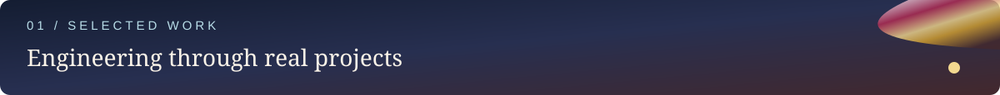
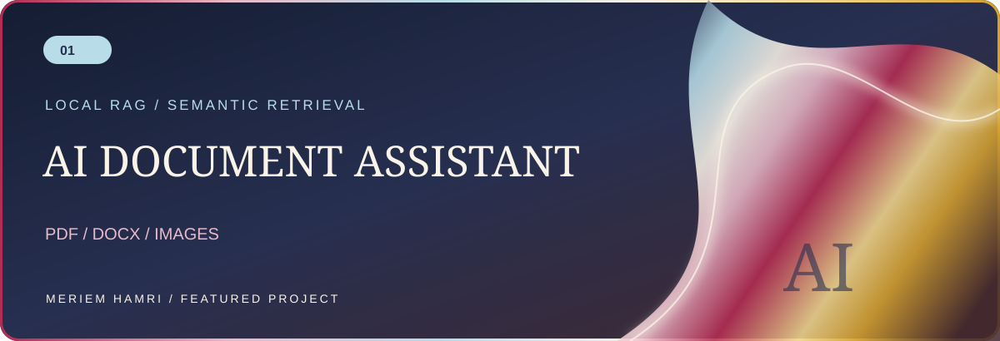
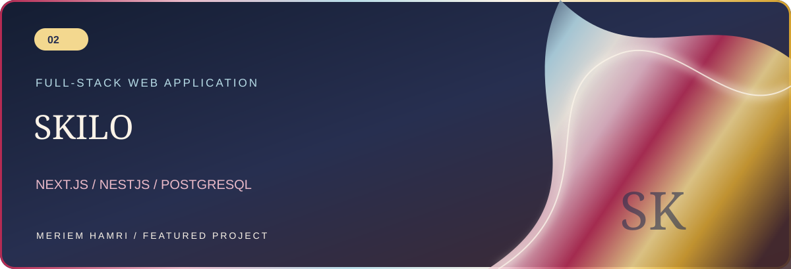
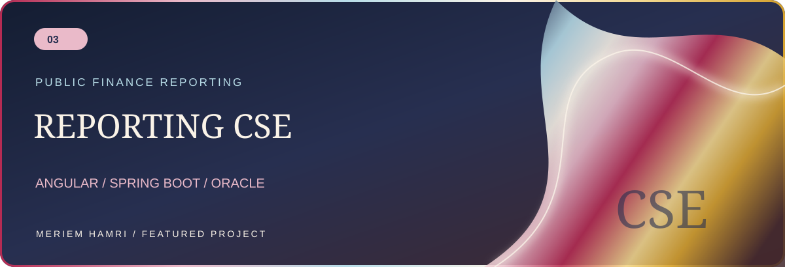
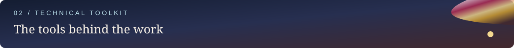
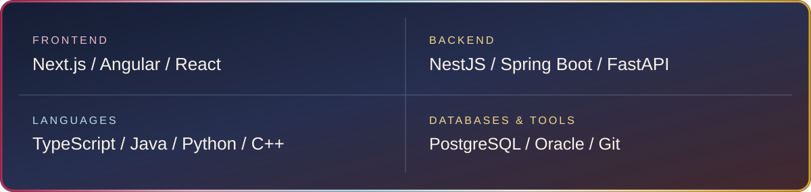

<!-- Profile README · V2 / Iridescent Tech Editorial -->

  

  <b>Software Engineering Student · Full-Stack Developer</b> 
  Building thoughtful software, from architecture to experience.

  <a href="https://github.com/Meriem-Hamri?tab=repositories">Explore repositories</a> &nbsp;•&nbsp;
  <a href="mailto:meriemhamri78@gmail.com">Email me</a>

I'm interested in creating reliable applications that are useful to people and well engineered behind the scenes. I work across frontend, backend and databases, and I enjoy exploring how good software architecture meets clear user experience.

**AI Document Assistant** — Local retrieval-augmented generation for PDF, DOCX and image documents, with searchable content and source-aware answers. **Python · FastAPI · ChromaDB · BGE-M3 · Qwen.** [Explore the code ↗](https://github.com/Meriem-Hamri/Ai_assistant)

**Skilo** — Full-stack project developed with **Next.js · NestJS · PostgreSQL · Prisma**. [Explore the code ↗](https://github.com/Meriem-Hamri/Skilo)

**Reporting CSE** — Reporting system for public financial accounts, developed during an internship at TGR with **Angular · Spring Boot · Oracle**. Internal screenshots and data are not published here.

I also work with REST APIs, authentication, Prisma ORM, document processing and semantic search.

  <a href="mailto:meriemhamri78@gmail.com"><b>Email</b></a> &nbsp; / &nbsp;
  <a href="https://github.com/Meriem-Hamri"><b>GitHub</b></a> &nbsp; / &nbsp;
  <a href="https://www.linkedin.com/in/meriem-hamri-b45637278"><b>LinkedIn</b></a>

Engineering with intention · Designed with a little iridescence

