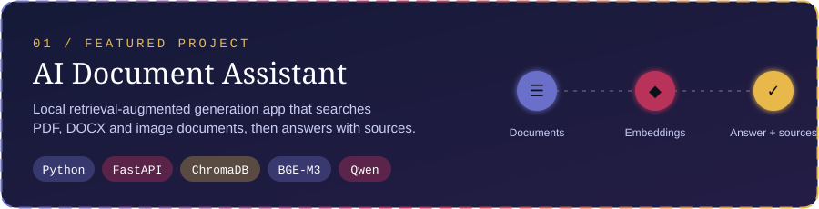
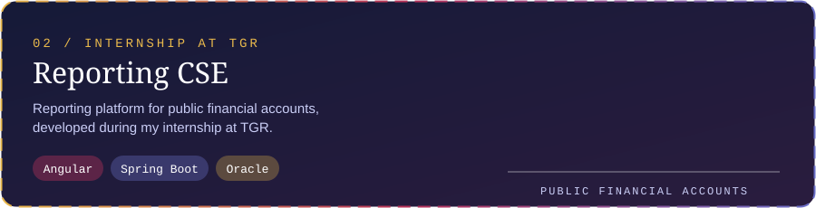

  

  
  
  

 

## 👋 About me

**Software Engineering Student · Full-Stack Developer**

I build useful software, from architecture to experience — with an interest in reliable systems, thoughtful interfaces, and the details that connect them.

---

## 🚀 Selected work

<!-- Replace each link below with the real repository URL of the project -->

 

---

## 🛠️ Tech stack

  

---

  Built with intention · 2026

