  

# Meriem Hamri
**Software Engineering Student · Full-Stack Developer**

I build useful software, from architecture to experience — with an interest in reliable systems, thoughtful interfaces, and the details that connect them.

[Projects](https://github.com/Meriem-Hamri?tab=repositories) · [LinkedIn](https://www.linkedin.com/in/meriem-hamri-b45637278) · [Email](mailto:meriemhamri78@gmail.com)

---

### Selected work

**01 — [AI Document Assistant](https://github.com/Meriem-Hamri/Ai_assistant)**  
A local retrieval-augmented generation application that searches PDF, DOCX, and image documents and generates answers supported by sources.  
`Python` · `FastAPI` · `ChromaDB` · `BGE-M3` · `Qwen`

**02 — Reporting CSE**  
A reporting platform for public financial accounts, developed during my internship at TGR.  
`Angular` · `Spring Boot` · `Oracle`  
*Project visuals will be shared only after anonymization.*

**03 — [Skilo](https://github.com/Meriem-Hamri/Skilo)**  
Full-stack application development with a modern web architecture.  
`Next.js` · `NestJS` · `PostgreSQL` · `Prisma`

---

### Technical toolkit

**Frontend** — Next.js, React, Angular, TypeScript  
**Backend** — NestJS, Spring Boot, FastAPI, Node.js  
**Databases** — PostgreSQL, Oracle, MySQL  
**Languages** — TypeScript, Java, Python, C++  
**Tools** — Git, GitHub, Prisma, Vercel

---

### Let's connect

[LinkedIn](https://www.linkedin.com/in/meriem-hamri-b45637278) · [Email](mailto:meriemhamri78@gmail.com)

<!-- The SVG uses declarative SMIL animations and has a complete static fallback.
     GitHub README does not support JavaScript or interactive 3D mouse tracking. -->
