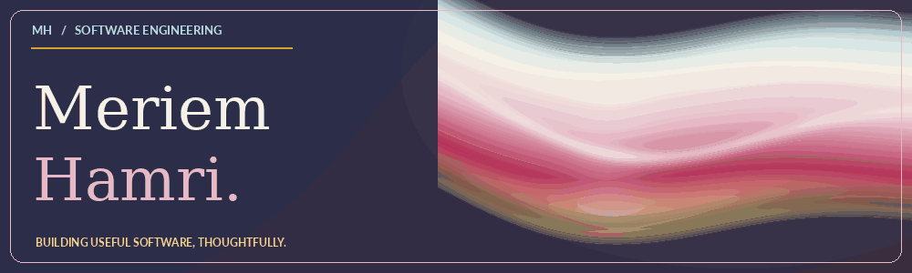
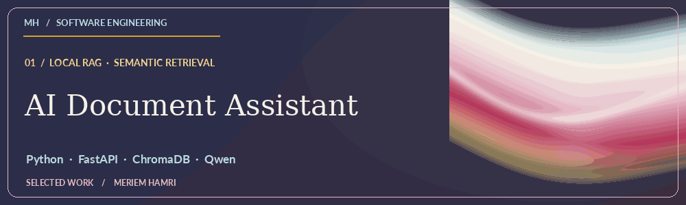
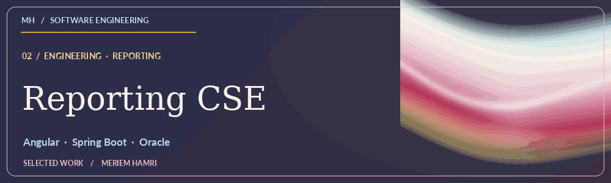
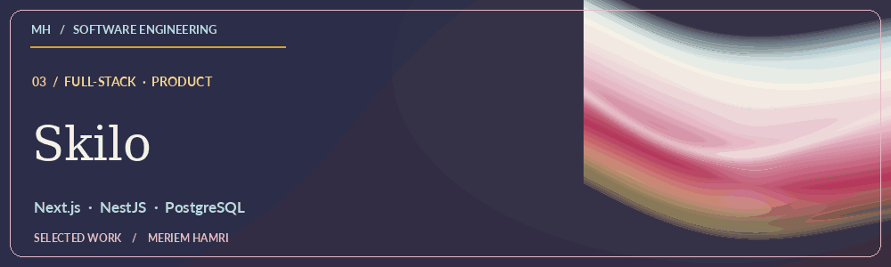

<h3 align="center">Software Engineering Student · Full-Stack Developer</h3>

Building thoughtful software, from architecture to experience.

<a href="https://github.com/Meriem-Hamri?tab=repositories">Explore repositories</a> · <a href="mailto:meriemhamri78@gmail.com">Email</a> · <a href="https://www.linkedin.com/in/meriem-hamri-b45637278">LinkedIn</a>

### 01 / About

I build full-stack applications and explore how software architecture, clear interfaces, and useful features work together. I enjoy learning by building: make it work, understand it deeply, then refine it.

### 02 / Selected work

**AI Document Assistant** — Local RAG for querying PDFs, DOCX files, and images with source-aware answers. **Python · FastAPI · BGE-M3 · ChromaDB · Qwen**. [Explore the code ↗](https://github.com/Meriem-Hamri/Ai_assistant)

**Reporting CSE** — Reporting application for public financial accounts, created during an internship at TGR. **Angular · Spring Boot · Oracle**. *(Any future screenshots must use anonymized data.)*

**Skilo** — Full-stack web application. **Next.js · NestJS · PostgreSQL · Prisma**. [Explore the code ↗](https://github.com/Meriem-Hamri/Skilo)

### 03 / Technical toolkit

**Frontend:** Next.js · React · Angular · TypeScript · Tailwind CSS  
**Backend:** NestJS · Node.js · Spring Boot · FastAPI  
**Databases:** PostgreSQL · Oracle · MySQL  
**Languages:** TypeScript · JavaScript · Java · Python · C++  
**Tools:** Git · GitHub · Prisma · Vercel

### 04 / Connect

[Email](mailto:meriemhamri78@gmail.com) · [LinkedIn](https://www.linkedin.com/in/meriem-hamri-b45637278) · [Repositories](https://github.com/Meriem-Hamri?tab=repositories)

Animated metallic reflections are pre-rendered GIFs; GitHub does not allow custom mouse-following JavaScript in a profile README.
